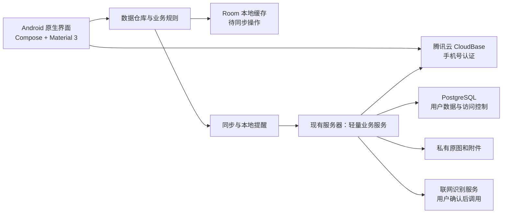

# 慢慢：产品与技术方案

版本：规划稿 0.4 ｜ 更新时间：2026-11-09

本文描述第一版的目标、拟定做法和验收方式。已确认的信息与待确认的业务规则分开标记；页面、配置、技术指标和资源预算均需以样例及真机验证为准。

## 1. 产品目标与边界

### 1.1 产品目标

让老师打开应用后，能迅速回答五件事：今天有什么待办、本周菜单、哪些学生请假、哪些学生不在校用餐、某项工作还有哪些学生未完成。应用负责记住原始信息和提醒，老师保留对结果的最终判断。

第一版先私下安装给一位班主任试用，账号与数据模型仍按用户隔离，允许同一账号更换手机后恢复云端数据。暂不假定有多人共同编辑、家长端、成绩管理或教务系统集成，也不以应用商店上架作为首版前提。

### 1.2 已确认的第一版范围

1. 手机号和短信验证码注册、登录；云端存储和同步。
2. 班级学生名单管理；按学生、日期登记请假。
3. 根据固定用餐设置和请假信息生成不在校用餐名单。
4. 全班网格标记“有 / 没有”类事项，保存记录及姓名汇总。
5. 查看本周菜单图片，没有图片时可以添加，已有图片可更换。
6. 输入课程表及作息，生成当天日程和可配置提醒。
7. 导入学校通知文字或图片，人工确认后可联网提取待办，并能从待办返回原通知。
8. 个人数据可从云端恢复；有备份、账号隔离和基本的安全保护。

第一版的所有识别结果都必须可修改，不能悄悄创建正式提醒或覆盖已有内容。云端不可用时，已登录设备尽可能继续查看缓存、记录变更，并清楚显示尚未同步的内容。

## 2. 典型的一天

1. 打开“今天”，查看并处理今日待办；顶部图标可直接进入本周菜单、学校通知或设置。
2. 学生提前或当天请假，在“记录”中选择学生、日期和时段并保存；不在校用餐名单自动更新。
3. 在“记录”中查看今天或其他日期的不在校用餐名单，按需复制姓名。名单由当前班级设置及现有请假实时计算。
4. 统计作业等班级事项时，新建标记，在学生网格中点选，保存后得到两组姓名和人数。已保存的班级标记按日期分组，可以折叠、编辑和复制。
5. 学校通知到来，从来源应用分享文字或图片到慢慢；若来源应用不提供系统分享，则复制文字或导入截图。查看即将发送的内容后，确认调用 AI，检查生成的事项和日期，再保存。
6. 查看本周菜单图片；本周还没有图片时手动添加。

## 3. 信息架构和页面

### 3.1 底部导航

| 入口 | 主要内容 | 主要操作 |
| --- | --- | --- |
| 今天 | 当天待办和日常功能图标 | 勾选、拖动排序、新建待办、查看全部待办 |
| 记录 | 请假、班级标记、不在校用餐名单 | 切换日期、复制名单、查找历史、编辑标记 |

班级与课程作息通过设置进入；设置、账号和同步状态可从首页进入。全部待办和班级标记按日期分组，可折叠；待办同一天内可拖动排序。

### 3.2 首页内容草图

以下是信息顺序示意，具体排版需根据手机尺寸和真实内容制作原型：

```text
11月8日                 像素嫩芽  通知  设置
星期日

今日待办                              全部图标  加号
□  提交班级材料                         拖动图标
☑  已完成事项（文字划线）                拖动图标

                    今天                记录
```

无数据时显示能直接完成下一步的提示，如“还没有学生名单，先添加学生”；网络断开时显示“已保存在本机，等待同步”，避免误以为已经上传。

### 3.3 Android 视觉与交互规范

- **配色**：拟以低饱和豆青色 `#536A5D` 作为唯一 seed，经 Material 色彩工具生成与之协调的主色层级；其余使用接近中性的浅深色阶。该 seed 与白色的对比度计算约为 5.85:1，但这不代表所有生成色和状态均达标；最终方案须逐项检查。关闭系统动态取色，避免由壁纸改变主题；不额外引入第二强调色。
- **层级**：使用 `surface`、`surfaceContainerLow/High` 等 M3 容器色区分区域，以留白为主，不依赖大面积描边、1dp 分隔线或堆叠卡片。
- **栅格**：主要间距使用 8、16、24、32dp，页面内容通常左右 16dp；横屏和大屏适配安全区及内容宽度。
- **文字**：优先 Android 系统中文字体，建议 22/18/16/14sp 四级，常规与中等两种字重；支持系统字体放大，不为了压缩页面截断关键信息。
- **字体选择**：提供系统、楷体、可爱和手写四种选择；三套开源中文字库按用户选择从自有服务器下载，下载后可离线使用，保留许可与系统字形回退。
- **字号及大字体布局**：默认跟随系统，设置中可单独选择偏小、标准、偏大、大或特大，不改变手机系统字体。按钮随内容增加高度，拥挤操作自动换行，学生网格按字号和可用宽度调整列数，内容过长时允许滚动；在大字号模拟器及目标手机复核。
- **圆角**：拟用 8/16/24dp 三档；大小按控件层级而非页面随意变化。
- **动效**：仅用于页面切换、勾选、展开和保存等状态变化，以 M3 `MotionScheme` 统一配置 200–300ms；点击反馈应立即出现，遵循系统减少动效设置。具体依赖版本需在构建时确认 API 稳定性。
- **可访问性**：点击区域至少 48×48dp；普通文字对比度至少 4.5:1；学生状态同时用文字或图标表达，不只靠颜色；兼容 TalkBack 和系统大字体。
- **视觉资产**：常用操作使用 Android 图标，本周菜单使用可识别的像素嫩芽；不把 emoji 用作导航，不预装字体、素材图库和与工作无关的装饰动画。

已参考 [ui-ux-pro-max-skill](https://github.com/nextlevelbuilder/ui-ux-pro-max-skill/blob/main/.claude/skills/ui-ux-pro-max/SKILL.md) 的 Android 触控与无障碍建议。其自动生成的营销页面结构和多强调色与本项目不符，已舍弃；以用户指定的 Android 和单色要求为准。

## 4. 业务功能设计

### 4.1 账号与注册登录

**已确认**：手机号 + 短信验证码，基础身份认证和短信验证码使用腾讯云 CloudBase。手机号、账号和登录会话由 CloudBase 托管；学生、请假、通知、菜单等业务数据拟放用户现有服务器。首次输入未注册手机号并验证后创建账号；已注册手机号验证后登录，具体注册配置以实测为准。

**流程**：输入手机号 → 申请验证码 → 输入验证码 → 成功后进入初始化或首页。手机号按服务端统一格式存储；错误和超时提供重试，不泄露不必要的账号信息。

**基础要求**：验证码有效期、发送间隔等以认证服务的实际可配置能力为准；要求具备手机号、IP 和全局限流、验证码尝试次数限制、短信费用上限及必要的人机验证。测试环境使用独立的测试账号与模拟短信，不在正式环境暴露固定验证码。

**会话与找回**：凭证通过 Android Keystore 保护；支持退出登录和会话失效。手机号变更、手机丢失后的身份恢复流程在上线前与短信服务能力一起确定，不能只依赖人工直接改数据库。

**前置条件**：CloudBase 环境和手机号验证码登录已开启，平台返回默认短信通道就绪；实际短信送达、登录流程、额度及费用尚需联调核实。官方不同文档对默认短信通道与自定义服务商的描述存在差异，是否需要单独的短信签名、模板及运营商报备，以该账号控制台实际配置为准。参见 [CloudBase 短信登录说明](https://docs.cloudbase.net/authentication-v2/method/sms-login)。

### 4.2 学生名单

- 每个账号可创建班级；初次使用引导添加学生。姓名、排序或学号均可配置，学号不是必填。
- 已确认优先从 Excel 复制姓名并粘贴；支持逐个录入、粘贴多行姓名和导入 UTF-8 CSV / TXT。粘贴后展示预览，逐行检查和修改，提示重名但允许老师确认两个同名学生。第一版不以原生解析 Excel 文件为前提，避免为此引入额外大型依赖。
- 学生使用内部稳定 ID，不能靠姓名作为唯一标识；支持改名、停用和班级变更。查看历史时保留当次姓名及成员快照，不因后来改名或退班改变当时的汇总。
- 不默认采集家长联系方式、身份证、照片或详细病情。名单与历史数据仅对所属账号可见。

### 4.3 请假与不在校用餐名单

**登记**：选择学生、开始日期、结束日期及上午 / 下午 / 全天；多天请假是一条记录，对覆盖日期逐天参与计算。列表按请假开始日期分组折叠，跨天记录只显示一次；允许修改、撤销和补录，已撤销的记录可确认删除并同步。

**计算规则**：

- 名单包含所选日期固定不在校用餐的有效学生，以及该日有全天或上午请假的有效学生；下午请假不加入。
- 允许设置长期不在校用餐或每周固定不在校用餐的星期。相同学生因多个原因入选时只显示一次，并标明原因。
- 按请假日期与时段计算，不受录入时间影响；新增、修改或撤销请假、修改固定用餐设置后，名单实时更新。
- 默认显示今天，可切换日期并复制姓名。历史日期也按当前学生设置及现有请假计算，不是历史快照。
- 不再提供午餐核验、核验截止时间、核验提醒、人工核验快照及按天手动调整。旧版已保存的核验和调整记录继续保留以兼容同步，但不参与新名单计算。

### 4.4 全班“有 / 没有”可视化

已确认：每次可以自定义事项和两种状态。为一次事项设置标题和两种标签，例如“语文作业：已交 / 未交”，进入全班网格，通过点击学生切换状态，顶部实时显示各组人数。52 名学生按屏宽安排约 4–5 列，名单可滚动、汇总保持可见；长姓名自动换行，颜色以外还用文字、勾选形状和无障碍状态说明。

新建时提供“全部设为状态一 / 状态二”的批量操作，初始状态在屏幕上明确显示。保存后记录两组姓名和创建时间，列表按日期分组并支持折叠，可重开查看、编辑或删除。编辑保留当时的名单和创建时间，不随班级名单变更而改变。

详情中两种状态分别提供复制按钮，直接复制对应姓名；不提供图片或图表导出。

### 4.5 食堂菜单

首页保留“本周菜单”入口；进入后直接展示本周已添加的菜单图片，支持查看和双指缩放。本周没有图片时可以选择添加，已有图片可以更换。菜单图片按周保存和同步。

不再进行菜谱识别或每日菜品录入，也不在首页显示“今天吃什么”。旧版已保存的每日菜单记录和菜单图片继续保留，避免数据丢失。

### 4.6 课程表、作息表与提醒

- 手动维护“节次和时间”与“每周课程”，例如周二第一节语文；时间表修改后自动重算后续日程。也可一次选择一至两张课程表 / 作息表图片，经用户确认后发送给 MiMo 识别；不支持 PDF 或 Excel 导入。
- 图片识别显示实际的读取、连接、发送、等待和模型返回阶段，以及已用时间；可停止识别，不虚构模型进度百分比。仅在发送图片之前的连接失败时自动重试；发送开始后不自动重复调用，避免重复计费。按星期预览结果，可缩放查看所选原图，并修改或补充节次、时间与课程；存在重叠时段时要求先核对。保存可合并，或经明确确认后替换全部；异常或不完整结果不能静默覆盖已有数据。
- 支持本周或指定日期的单次调课、停课；节假日及调休日提供手动覆盖，不仅以周一至周五推断是否上课。
- 提醒可选每节课前、每天开始前汇总或关闭，提前多久由老师设置。临时待办可设置截止时间和独立的提醒时间，不要求所有待办都有明确时刻。
- 首页仅显示当天待办；其他日期及未安排日期的待办在全部待办中按日期查看。已完成事项划线，已完成 / 已取消的事项不再提醒。
- 处理设备重启、日期 / 时区变化、权限变化和任务更新后的重新安排；设置页显示通知权限及精确提醒能力是否可用。拒绝精确提醒时，说明可能延迟并提供系统允许的近似提醒，不声称仍能准时送达。

Android 13 起通知通常需要运行时授权；Android 14 上许多新安装应用的精确提醒权限默认未授予。以实际使用的小米 12S 为首要真机，确认其 Android / MIUI 或 HyperOS 版本，并测试通知、系统省电策略和重启后的提醒行为。[通知权限](https://developer.android.com/develop/ui/compose/notifications/notification-permission)；[精确提醒限制](https://developer.android.com/about/versions/14/changes/schedule-exact-alarms)。

### 4.7 通知转待办

**输入**：接收系统分享的文字、单张或多张图片；也提供粘贴文字和系统图片选择。源应用是否支持系统分享由其自身决定，不读取其他应用聊天记录、不申请通知监听来抓取私人消息。

**处理**：

1. 保存原文或图片，允许老师选择哪些内容用于分析。
2. 每次显示待发送内容、服务名称和用途，老师确认后才把该次通知交给联网 AI；允许取消或手动建立待办。
3. AI 返回候选事项：标题、可识别的日期 / 时间、建议提醒、依据的原文片段及“不确定”标记。一条通知可对应多条候选事项；无明确时间时不猜日期。
4. 老师逐条编辑、选择并确认，才生成正式待办和提醒。待办详情始终能查看对应原文 / 图片；删除通知或附件前说明对关联待办的影响。
5. 不把通知里的文字当成系统命令执行，也不自动发送消息、修改其他数据或代替老师确认。

原文和图片保存到自己的云服务器属于已确认的云存储范围；第三方 AI 调用是另外的操作，每次确认。服务商的数据使用、存储时间和费用需在接入前确认。

## 5. 技术方案

### 5.1 总体结构



### 5.2 Android 客户端

| 能力 | 初步方案 | 理由与约束 |
| --- | --- | --- |
| 开发语言 / UI | Kotlin、Jetpack Compose、Material 3 | 原生体验、统一 Android 组件与主题；不用 WebView 承载主界面 |
| 状态管理 | ViewModel、Kotlin Coroutines / Flow | 页面状态与可取消异步工作分离 |
| 本地结构化缓存 | Room / SQLite | 列表、离线写入队列及历史记录；按账号隔离 |
| 用户设置 | DataStore | 主题、提醒偏好等小型设置；业务数据仍放数据库 |
| 图片加载 | 按需评估 Coil | 展示、缩放和缓存图片；衡量依赖体积后引入 |
| 同步 | WorkManager 处理可延迟的重试 | 仅用于同步和维护，不依赖其进行精确到点提醒 |
| 定时提醒 | AlarmManager + Android 通知 | 根据权限选择精确或近似模式，并实机验证 |
| 图片和文件导入 | Android Photo Picker、系统文件选择器和分享 Intent | 尽量避免申请全部照片或存储权限 |
| 网络与数据编码 | 轻量 HTTP 客户端 + JSON | 在可靠性、包大小和服务端 SDK 之间做构建实测，避免重复引入同类库 |

暂定最低支持 Android 8.0 / API 26；须根据实际手机、依赖支持范围和测试成本调整。使用当前可获得且兼容的稳定依赖，在项目中锁定版本与许可证；不以本规划日期猜测未来库版本。

### 5.3 云端选型建议

**现有资源**：腾讯云轻量应用服务器，2 核 CPU、2GB 内存、50GB SSD、Ubuntu 24.04.4 LTS。用户表示服务器目前空闲；本次 SSH 只读检查显示可用内存约 1.1 GiB、系统盘可用约 35 GB，Docker 未安装。服务器 SSH 主机指纹已由用户通过腾讯云网页终端独立核对，专用连接配置已启用严格主机密钥检查。完整自托管 Supabase 官方最低要求 4GB 内存，因此不建议直接把完整套件塞进这台服务器。[Supabase 官方部署要求](https://supabase.com/docs/guides/self-hosting/docker)。不需要为了这个方案重装系统。

**业务端暂定组合**：现有服务器运行单一轻量 Go 业务服务、PostgreSQL、HTTPS 反向代理和私有附件存储；基础身份认证改由腾讯云 CloudBase 托管。手机号、账号和会话在 CloudBase，学生和班级业务数据及附件仍在现有服务器。先做资源与安全验证，再锁定最终组件。

**身份认证：CloudBase**。用户已决定使用 CloudBase 提供手机号验证码注册和登录，以降低现有服务器内存负担。Android 端优先使用其 [身份认证 HTTP API](https://docs.cloudbase.net/ai/cloudbase-ai-toolkit/prompts/auth-http-api)，避免为了登录引入 WebView；注册、验证、登录、刷新和退出的具体流程以环境实测为准。手机上的登录令牌须妥善保存，不把腾讯云管理员 API Key 写入 APK。自托管 Ory Kratos 保留为历史调研参考，当前不部署。

**CloudBase 价格参考**：存在每月 3,000 资源点的免费体验环境，基础能力包含短信验证码登录；需每 6 个月手动续期，免费环境有功能及配额限制，不能视为永久无限免费。[CloudBase 价格说明](https://cloud.tencent.com/document/product/876/127357)。官方文档对短信默认通道与单独接入短信服务的配置描述存在差异，短信额度是否抵扣、是否需要独立购买及实际资质须按账号和控制台核实，不预先承诺免费。

**身份校验**：服务端必须通过认证服务验证访问凭证并取得用户身份，不能直接信任客户端传来的用户 ID，或只解码令牌而不验证。CloudBase 当前用户接口可能省略可选的状态字段：成功响应且有有效用户标识时使用已验证身份，明确返回非激活状态时拒绝；认证服务异常与令牌失效分别处理。认证服务不可用时服务器拒绝未验证请求，手机保留离线写入待恢复后同步。短信或管理密钥不放进 APK。

**数据访问**：每条业务记录绑定经验证的用户 ID；API 必须对读、写、删除及跨表引用做所有权校验，数据库再配置行级权限作为纵深防护。业务连接使用不能绕过行级权限的低权限角色，在事务内设置已验证的用户上下文，并测试连接复用不会串用其他用户的上下文。文件在应用私有路径存放，经同一所有权校验后按需读取；禁止静态公开文件目录和猜测路径直接下载。事务、索引、数据库迁移和独立备份按业务需求实现。参见 [PostgreSQL 行级安全](https://www.postgresql.org/docs/current/ddl-rowsecurity.html)。

**资源验收**：在不影响现有服务的条件下，用测试数据测量启动后及同步、图片上传、备份高峰时的内存、CPU、磁盘；确定可用余量和保护阈值。若不满足，优化或扩容，不能关闭账号隔离或备份来硬凑。此时仅为候选设计，尚未在该服务器部署或测量。

### 5.4 本地与云端同步

- 首次登录、注册以及其他必须验证身份的操作需要网络。已登录且已有缓存时，可离线查看并新增 / 修改本机数据；数据变更和同步队列在本地原子保存。
- 每条记录使用稳定 ID；客户端变更带操作 ID，服务端幂等处理重试；服务器维护版本和删除标记，避免重试造成重复、已删除记录被重新同步回来。
- 联网后先同步变更并增量拉取；列表显示“待同步 / 同步失败 / 已同步”，失败可重试。单个设备退出登录时，如有未同步数据，应明确提示，不能静默删除；成功同步后的本地数据按账号隔离清理。
- 同一账号换机时从云端恢复；两台设备同时离线修改同一记录时，先尝试基于版本检测冲突并保留双方内容，提示用户处理，不静默以最后一次提交覆盖请假等记录。
- 图片上传失败不影响原始本地记录；文件上传、记录绑定和重试要能恢复，清理未绑定附件。云端作为跨设备恢复的数据来源，本地尚未上传的变化不视为已备份。

上述同步协议是本项目需要实现和测试的应用逻辑，后端产品本身不自动保证所有冲突处理。可参考 Android 官方 [离线优先架构](https://developer.android.com/topic/architecture/data-layer/offline-first)。

### 5.5 关键数据对象

| 对象 | 关键字段及关系 |
| --- | --- |
| 用户、会话 | 用户 ID、手机号、会话；手机号不得作为业务主键 |
| 班级、学生 | 所属用户、班级、稳定学生 ID、姓名、排序、有效状态 / 生效日期及长期用餐习惯 |
| 请假 | 学生 ID、起止日期与时段、登记时间、状态、午餐影响及可选备注 |
| 不在校用餐名单 | 不单独存快照；由当前学生固定用餐设置及所选日期的有效请假计算 |
| 标记记录 | 事项标题、状态名称、每个学生的状态和当时姓名快照 |
| 菜单 | 周起始日、菜单图片来源；旧版每日菜单记录保留以兼容同步 |
| 课程与作息 | 周课程、节次、作息时间、指定日期的覆盖规则 |
| 通知、附件、任务 | 原文或附件及其所有者；一个通知关联多个待办；待办含时间、提醒和完成状态 |
| 同步操作 | 所属用户、操作 ID、记录 ID、版本、状态与重试信息 |

每类记录保留合理的创建 / 修改时间；同步冲突不依赖不可靠的手机本地时间来判断谁覆盖谁。业务表、附件、历史快照和备份都必须遵守同一账号隔离策略。

## 6. 安全、隐私和备份

- 学生名单、请假和学校通知可能涉及未成年人个人信息。默认最小采集，请假原因不强制填写；正式用于学校工作前，确认学校对学生数据上传、第三方识别和使用范围的要求及必要授权。[个人信息保护法](https://www.cac.gov.cn/2021-08/20/c_1631050028355286.htm) 将不满十四周岁未成年人的个人信息列为敏感个人信息。
- 手机端使用应用私有目录和 Android Keystore 保护会话；通知默认不在锁屏展示敏感姓名。云端只开放必要端口和 HTTPS；管理后台限制访问，管理员启用更强认证，定期更新。
- 图片和原通知默认私有，普通用户不能读取其他账号的对象；AI、短信及服务器管理凭据仅在服务端保存，日志不记录验证码、会话令牌、完整通知和学生名单。
- 云端备份同时覆盖数据库和附件，使用加密备份并保存到独立位置；设计数据库与附件的一致性校验，每日备份作为初始目标，定期在隔离环境演练恢复。服务器自身故障、误删和单次快照并不能等同于可恢复备份。
- 提供用户主动导出和删除的设计；删除后服务端及备份保留期限、账号注销流程在实际部署前明确。手机端人工导出如包含学生数据，使用可跨设备恢复的加密备份，而非仅依赖无法迁移的设备密钥。

## 7. 性能与体积目标

以下是待实测的工程目标，不是现有实现的测试结果：

- **安装包**：以发布构建的 `arm64-v8a` APK 为基准，初定 ≤15 MiB；单独报告通用 APK、安装后占用、后续模型下载量和用户图片数据占用。若验证后不能兼顾需求和目标，列出实际构成再调整。
- **启动**：已登录、有缓存的状态下，在小米 12S 上做至少 30 次冷启动，记录首次画面和首页数据可用时间，目标 P95 分别 ≤1.5 秒和 ≤2 秒；新设备首次登录、云端下载和联网识别单独计时。
- **流畅度**：在目标设备上录制首页滚动、学生网格点击与菜单切换的帧耗时，定位掉帧与主线程阻塞；不以模拟器结果代替真机。
- **节省体积**：启用发布构建代码与资源压缩，按 ABI 评估分发；避免打包完整 AI 模型、整套多余图标、无用字体和重复网络库。每增加主要依赖记录实际增量。
- **节省流量与存储**：列表图片按显示尺寸解码；菜单和通知图片按需加载、失败可重试，避免重复上传。

参考 Android [应用体积优化](https://developer.android.com/topic/performance/reduce-apk-size) 与 [性能测量](https://developer.android.com/topic/performance/measuring-performance)。

## 8. 开源参考与复用边界

| 项目 | 参考 / 复用点 | 备注 |
| --- | --- | --- |
| [Now in Android](https://github.com/android/nowinandroid) | Compose、分层架构、离线数据流 | Apache-2.0；按实际需求取舍，不照搬大型示例的全部模块 |
| [PostgreSQL](https://www.postgresql.org/) | 开源数据库、事务、行级权限 | 评估现有服务器的内存占用和备份；开源许可证以项目文本为准 |
| [CloudBase 身份认证](https://docs.cloudbase.net/authentication-v2/auth/introduce) | 已选择的手机号验证码认证 | 托管服务，非开源；需要验证短信通道、费用与服务端鉴权 |
| [Ory Kratos](https://github.com/ory/kratos) | 自托管身份认证历史备选 | 当前不部署；如未来切换，需验证资源、短信适配和安全更新条件 |
| [Supabase](https://github.com/supabase/supabase) | 认证、数据库、存储和访问控制参考 | 完整套件官方最低 4GB 内存；当前机器不作为直接部署首选 |
| [Coil](https://github.com/coil-kt/coil) | Android / Compose 图片加载 | Apache-2.0；先测安装包增量 |
| [Fossify Calendar](https://github.com/FossifyOrg/Calendar) | 日历与提醒交互、边界场景 | GPL-3.0；先作为产品和工程思路参考，如复制代码须先评估许可证义务 |
| [ui-ux-pro-max-skill](https://github.com/nextlevelbuilder/ui-ux-pro-max-skill) | 移动端触控、无障碍和设计检查 | 采用 Android 原生建议；不套用其不适用的网页营销布局 |

引入任何开源代码或依赖前，核对维护状态、许可证、升级兼容性与安全公告；保留必要的版权和许可说明。

## 9. 实施顺序

每一步都产出可安装或可验证的结果；正式数据迁入前先用脱敏样例与测试账号验证。

1. **需求与验证样例**：确认午餐规则、手机和服务器配置；制作 Android 低保真原型，并准备脱敏通知样例。
2. **基础设施与账号**：建立 Android 项目、主题、导航、本地数据库；搭建测试云环境、账号隔离、手机号验证码流程、私有存储和备份恢复演练。短信服务未审批时以隔离的模拟通道验证流程。
3. **核心班级闭环**：实现名单、跨天请假、实时不在校用餐名单及全班标记快照；完成离线写入、同步状态、去重和冲突处理。
4. **日程与菜单闭环**：手动输入作息和课程表、可靠提醒；支持添加和查看本周菜单图片。
5. **通知和识别闭环**：支持系统分享文字 / 图片，接入通知识别，完成每次发送确认、人工校对、待办关联原件和异常降级。
6. **上线前试用**：在目标手机连续使用、测量体积与启动、测试通知可靠性和同步恢复；验证账号越权、学生数据访问控制、备份恢复与短信额度。根据实际试用修正界面与规则。

## 10. 验收清单

### 10.1 主要工作流

- 完成注册、登录、退出、再次登录；验证码错误 / 过期 / 频繁申请的反馈清楚。
- 从 Excel 复制并粘贴包含重名的学生名单；改名或退班后历史标记仍显示当时成员和姓名。
- 跨天、重叠、撤销及补录的全天或上午请假均能反映到相关日期，下午请假不计入；固定不在校用餐和请假重合时姓名只出现一次。名单可切换日期并复制，规则及请假变化后实时更新。
- 旧版午餐核验、手动调整及截止时间记录在升级后继续保留兼容同步，但不参与新名单计算。
- 创建一次班级标记，能查看自定义两组学生的姓名 / 数量，初始状态清晰；界面状态不只靠颜色区分。
- 标记记录可按日期折叠、编辑或删除，日期与原始名单保留；两个状态均可单独复制对应姓名。
- 今日仅展示当天待办；全部待办可折叠日期分组，同一天内拖动后重新打开仍保留顺序，勾选完成后文字划线。
- 本周没有菜单时可以添加图片；已有图片进入页面可直接查看、缩放和更换；旧版菜单记录不会被删除。
- 导入文字及图片通知，确认发送后可生成多条候选待办；每条正式待办可查看来源；无时间信息时不杜撰时间。
- 一次选择课程表和作息表两张图片，确认后看到真实识别阶段；对照每个星期预览并修改候选，校验周一与其他星期时间差异、跨节活动及冲突，确认后才保存。
- 修改课程表、单次调课、完成待办和重启手机后，提醒计划正确更新；权限关闭和低电量等状态有清楚提示。

### 10.2 数据可靠性与安全

- 断网记录、连续修改、恢复网络、重复重试均不丢失或产生重复；未同步状态可见。
- 两个账号无法通过修改 ID、文件路径或请求参数读取 / 更改对方学生、记录、原通知或图片。
- 换机登录能恢复已同步数据；离线未同步时退出有明确提示；多设备冲突不会静默覆盖。
- 用备份在隔离环境恢复数据库和附件，验证二者匹配；验证备份加密和权限。
- 校验短信限流、过期、重复使用、日志脱敏；确保应用安装包和客户端日志没有服务器密钥。
- 使用目标手机检查 Android 通知授权、精确提醒、系统省电限制、时间变化及重启后的实际表现。

### 10.3 识别与 UI

- 用脱敏通知样例记录识别正确、缺失、错配和人工修正情况，覆盖模糊图片和多事项，不在样例不足时承诺准确率。
- 对小屏手机、目标机型、大字体、横屏和深色主题做实际检查；验证触摸区域、文本对比度、TalkBack、键盘不遮挡输入和减少动效设置。
- 构建并报告实际 APK 大小、依赖构成、冷启动和滚动数据；出现偏差时列明取舍。

## 11. 待确认与外部成本

1. **服务器与账号**：2 核、2GB、50GB SSD、Ubuntu 24.04，SSH 已连通且主机指纹独立核对一致。CloudBase 插件已登录、环境状态正常，手机号验证码登录已开启且默认通道显示就绪；仍需验证实际短信送达、登录、费用、域名和备份位置。具体见 [腾讯云接入准备](腾讯云接入准备.md)。
2. **手机**：已知小米 12S，仍需确认 Android、MIUI 或 HyperOS 版本，以及实际提醒与省电策略。
3. **用餐名单**：以当前学生固定用餐设置及现有请假实时计算，不以录入时间或历史核验快照为准；如未来需要按学期留存历史，应另行确认。
4. **班级标记**：班级 52 人，名单从 Excel 复制粘贴；仍需确认最常见的两三个事项例子及默认状态如何选择。
5. **识别素材**：脱敏的文字和图片通知，用于检验通知转待办的准确性。
6. **费用**：现有服务器续费 / 升配、云备份或对象存储、短信发送、联网图片识别均可能产生费用；在确定服务商和预计用量前不估算具体金额。
